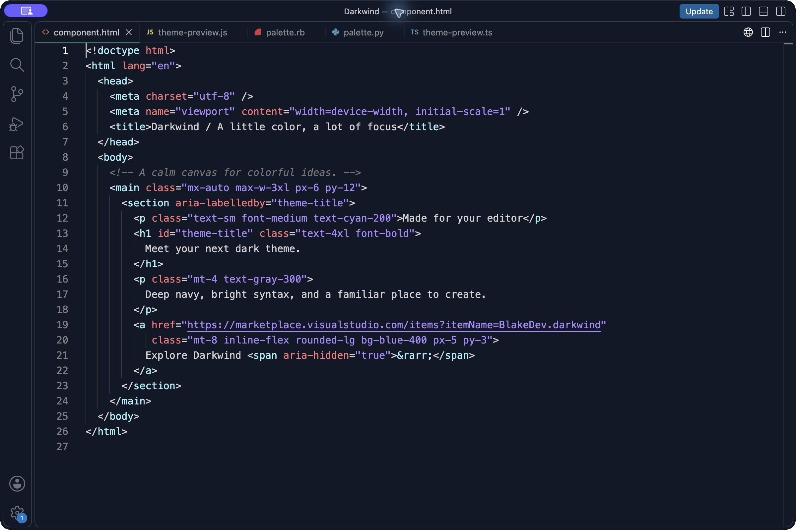
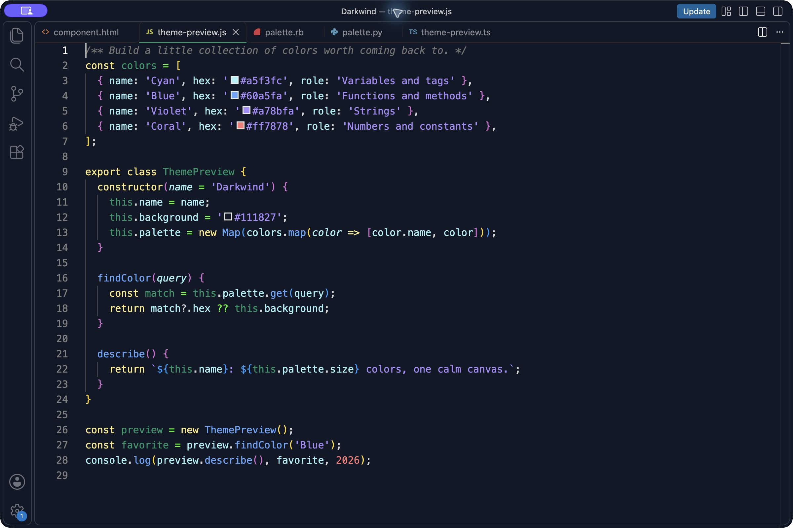
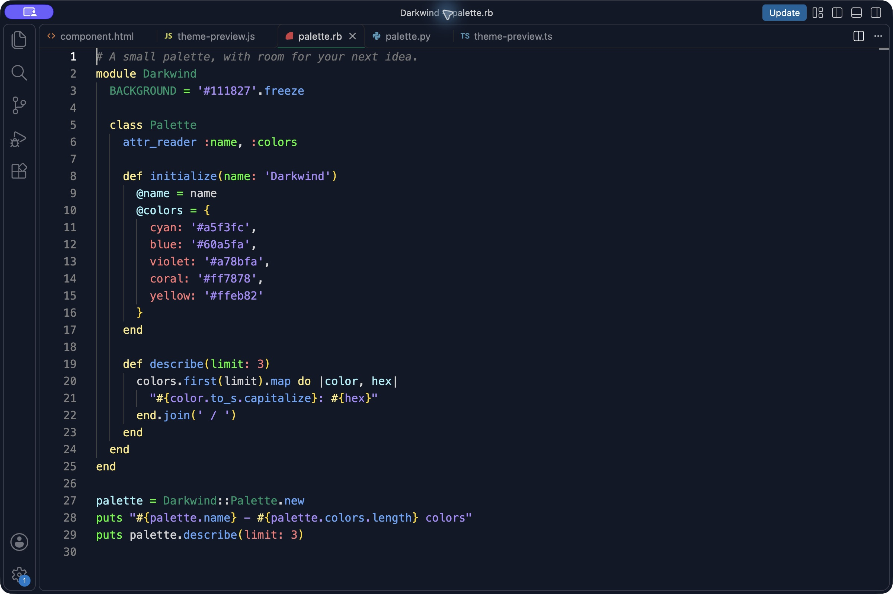
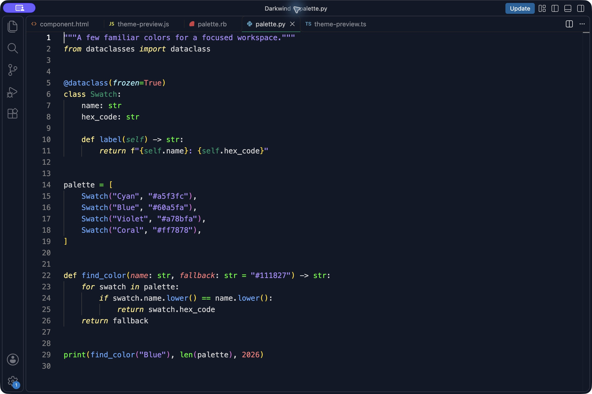
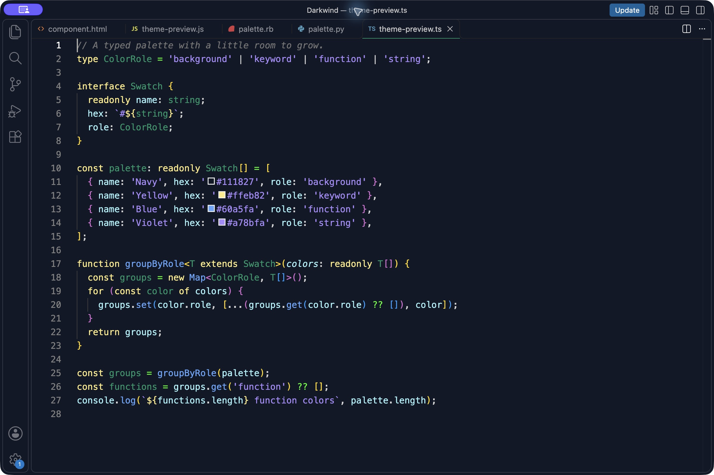
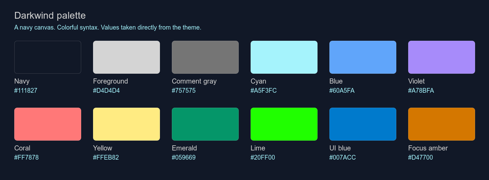

# Darkwind

A dark theme for Visual Studio Code inspired by Tailwind's color palette. Darkwind pairs a deep gray background with colorful syntax highlighting, with readability in mind.

[Created by Blake Campbell](https://blakecampbell.com/uses/#darkwind)

[Install from the Visual Studio Marketplace](https://marketplace.visualstudio.com/items?itemName=BlakeDev.darkwind)

## Installation

Requires Visual Studio Code 1.56.0 or later.

1. Open the **Extensions** view in VS Code.
2. Search for **Darkwind** by **BlakeDev** and select **Install**.
3. Open the Command Palette with `Ctrl+Shift+P` (Windows/Linux) or `Cmd+Shift+P` (macOS).
4. Run **Preferences: Color Theme** and select **Darkwind**.

You can also select the theme in your `settings.json`:

```json
{
  "workbench.colorTheme": "Darkwind"
}
```

## Screenshots

Captured in VS Code with Darkwind applied, using Menlo at 15 px. The examples show the theme's actual syntax colors; no colors were added to the screenshots.

### Component HTML

Cyan tags, coral attributes, violet strings, and muted italic comments on the navy editor background.



### JavaScript

Yellow keywords, blue functions, emerald types and constants, and cyan variables. Semantic highlighting is enabled by the theme.



### Ruby

Classes, methods, symbols, numbers, and string interpolation in a compact Ruby example.



### Python

Type annotations, a dataclass, control flow, and formatted strings in a small palette lookup.



### TypeScript

Interfaces, literal types, generics, and typed collections with semantic highlighting enabled.



## Color palette



These are the main colors defined in Darkwind. Language-specific TextMate rules and semantic highlighting can change which color a particular token receives.

| Color | Hex | Main uses |
| --- | --- | --- |
| Navy | `#111827` | Editor and sidebar background |
| Foreground | `#D4D4D4` | Default text and punctuation |
| Comment gray | `#757575` | Comments |
| Cyan | `#A5F3FC` | Variables and HTML tags |
| Blue | `#60A5FA` | Functions and methods |
| Violet | `#A78BFA` | Strings |
| Coral | `#FF7878` | Numbers, constants, attributes |
| Yellow | `#FFEB82` | Keywords and control flow |
| Emerald | `#059669` | Types, classes, language variables |
| Lime | `#20FF00` | Many operators, symbols, escapes |
| UI blue | `#007ACC` | Status bar background |
| Focus amber | `#D47700` | Focus borders |

The icon uses the same navy, cyan, and blue. The theme color definitions are unchanged in this release.

## Development

1. Clone the repository and open it in VS Code:

   ```sh
   git clone https://github.com/BlakeCampbells/Darkwind.git
   cd Darkwind
   code .
   ```

2. Press `F5` to launch an **Extension Development Host** window using the included launch configuration.
3. In that window, run **Preferences: Color Theme** from the Command Palette and select **Darkwind**.
4. Edit `themes/Darkwind-color-theme.json` in the original window. Changes appear automatically in the development window.

No dependency installation or build step is needed to preview the theme.

The main files are:

- [`themes/Darkwind-color-theme.json`](themes/Darkwind-color-theme.json): workbench colors, TextMate syntax rules, and semantic token colors.
- [`package.json`](package.json): extension metadata, VS Code compatibility, and theme registration.
- [`.vscode/launch.json`](.vscode/launch.json): configuration for previewing the theme locally.

### Validation and packaging

Release tooling requires Node.js 22 or later and npm. This is separate from the VS Code version required to use the theme.

Run the theme checks without installing dependencies:

```sh
npm test
```

The checks validate theme registration, color values, scope selectors, font styles, overlay transparency, and indentation guide compatibility.

Install the pinned packaging tool, inspect the files that will ship, and build a VSIX:

```sh
npm ci
npm run package:contents
npm run package
```

Packaging runs the checks first and creates a local VSIX using the version in `package.json`. Before publishing a new release, review the theme in the Extension Development Host, update the version in `package.json`, and record the release in `CHANGELOG.md`.

## Contributing

To report hard-to-read syntax or unexpected colors, [open an issue](https://github.com/BlakeCampbells/Darkwind/issues) with the language, a small code sample, and a screenshot.

Pull requests are welcome. Describe the colors or scopes you changed and include before-and-after screenshots so the changes are easy to review.

## License

Darkwind is available under the [MIT License](LICENSE).

## Resources

- [VS Code themes and customization](https://code.visualstudio.com/docs/configure/themes)
- [Creating and testing a color theme](https://code.visualstudio.com/api/extension-guides/color-theme)
- [Publishing a VS Code extension](https://code.visualstudio.com/api/working-with-extensions/publishing-extension)
- [Changelog](CHANGELOG.md)
