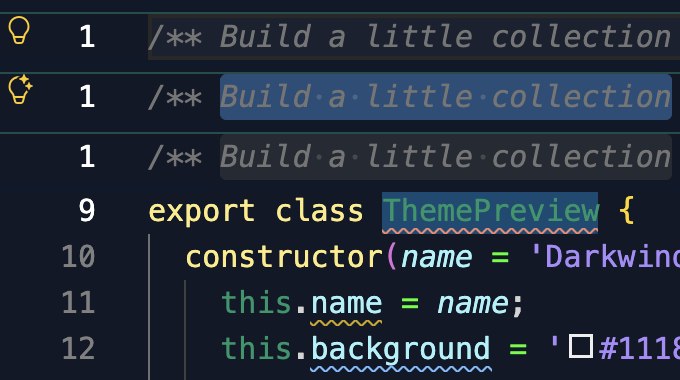

# Darkwind 1.0.4 release verification

Verified on November 27, 2026. The `v1.0.4` tag points to `4476c265`. [Tagged source](https://github.com/BlakeCampbells/Darkwind/tree/v1.0.4)

## Editor readability

I installed the local VSIX in an empty VS Code 1.147.0 profile on macOS arm64. I selected **Darkwind**, set Menlo to 15 px, and kept `editor.semanticHighlighting.enabled` at `configuredByTheme`. VS Code returned semantic tokens for JavaScript and TypeScript. Ruby used the built-in TextMate grammar in this profile. [Documented setup](../../README.md) · [Theme colors](../../themes/Darkwind-color-theme.json)

I opened the three showcase files as committed. For each file, I put the cursor on the opening comment, selected part of it, and moved focus to the sidebar to leave an inactive selection. I repeated the active-line and focused-selection checks on a green type or class name. A temporary extension added error, warning, and information diagnostics to existing tokens so the samples needed no edits.

| Sample | Selected comment | Error | Warning | Information |
| --- | --- | --- | --- | --- |
| [JavaScript](../showcase/theme-preview.js) | Line 1, `Build a little collection` | Line 9, `ThemePreview` | Line 11, `name` | Line 12, `background` |
| [TypeScript](../showcase/theme-preview.ts) | Line 1, `A typed palette` | Line 4, `Swatch` | Line 6, `hex` | Line 7, `ColorRole` |
| [Ruby](../showcase/palette.rb) | Line 1, `A small palette` | Line 5, `Palette` | Line 9, `@name` | Line 11, `cyan` |

The focused selection was easy to find, but the gray comment was hard to read inside it in all three samples. The green identifier also lost contrast on the selection. The active-line fill was subtle at 1.10:1 against the editor background. Its bright line number still marked the cursor row. All three diagnostic squiggles were distinguishable by color, including the error squiggle under the selected green identifier.

| State | Background | Gray comment `#757575` | Default text `#D4D4D4` | Green identifier `#059669` |
| --- | --- | ---: | ---: | ---: |
| Editor | `#111827` | 3.85:1 | 11.97:1 | 4.71:1 |
| Active line | `#1A212F` | 3.50:1 | 10.88:1 | 4.28:1 |
| Focused selection | `#264F78` | 1.84:1 | 5.73:1 | 2.25:1 |
| Unfocused selection | `#262B34` | 3.08:1 | 9.59:1 | 3.77:1 |

Ratios use the theme colors. The active-line and unfocused-selection backgrounds are the overlays blended over the editor background and rounded to 8-bit RGB.

## Local package and Marketplace

- `npm run package:contents` and `npm run package` succeeded with VSCE 4.1.0. All eight theme tests passed. VS Code installed `blakedev.darkwind@1.0.4` from the local VSIX in the empty profile.
- The package contains the `Darkwind` theme, `themes/Darkwind-color-theme.json`, a 256 × 256 `icon.png`, and the five language screenshots and palette image under `docs/screenshots/`. The installed files and manifest matched the package after accounting for VS Code's install metadata. The manifest version matched the changelog. The README credit link and manifest homepage matched the links described in the 1.0.4 entry. [Manifest](../../package.json) · [Changelog](../../CHANGELOG.md)
- The Marketplace listed `BlakeDev.darkwind` at 1.0.4. All 14 extracted entries matched the local build byte for byte. The Marketplace homepage and **Created by Blake Campbell** link both pointed to the portfolio entry. The entry returned HTTP 200 and linked back to `BlakeDev.darkwind`. [Marketplace listing](https://marketplace.visualstudio.com/items?itemName=BlakeDev.darkwind) · [Portfolio entry](https://blakecampbell.com/uses/#darkwind)
- All six screenshot URLs in the Marketplace README returned HTTP 200 and served the same image bytes as the package. VSCE rewrites these URLs to GitHub's `raw/HEAD` paths, so the displayed images follow the default branch.
